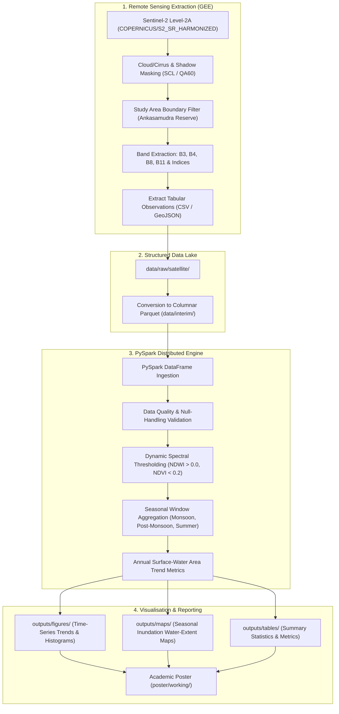

# Big Data Architecture — LAKE 2026

**Project**: Big Data Analytics of Multi-Year Sentinel-2 Satellite Imagery for Seasonal Surface-Water Monitoring at Ankasamudra Bird Conservation Reserve, Karnataka  
**Scale**: Multi-year time-series (2018–2025) @ 10m/20m spatial resolution across ~100+ acquisitions.

---

## 1. High-Level Architectural Flowchart

---

## 2. Spectral Indices & Physics Formulation

### 2.1 Normalized Difference Water Index (NDWI)
$$NDWI = \frac{\rho_{Green} - \rho_{NIR}}{\rho_{Green} + \rho_{NIR}} = \frac{B3 - B8}{B3 + B8}$$
- Water bodies exhibit strong reflectance in the Green band (B3) and strong absorption in the Near-Infrared (B8).
- Positive values generally correspond to open surface water.

### 2.2 Normalized Difference Vegetation Index (NDVI)
$$NDVI = \frac{\rho_{NIR} - \rho_{Red}}{\rho_{NIR} + \rho_{Red}} = \frac{B8 - B4}{B8 + B4}$$
- Distinguishes aquatic macrophytes, emergent vegetation, and surrounding canopy from open water bodies.

### 2.3 Modified NDWI (MNDWI - Optional Comparison)
$$MNDWI = \frac{\rho_{Green} - \rho_{SWIR}}{\rho_{Green} + \rho_{SWIR}} = \frac{B3 - B11}{B3 + B11}$$
- Replaces NIR with SWIR (B11) to suppress soil and built-up noise around the wetland margin.

---

## 3. Data Schema & Schema Mapping
Expected tabular dataset fields for PySpark ingestion:
- `date`: ISO 8601 string / Timestamp (`YYYY-MM-DD`)
- `year`: Integer
- `month`: Integer
- `season`: Category (`Pre-Monsoon/Summer`, `Monsoon`, `Post-Monsoon/Winter`)
- `pixel_id`: Unique spatial identifier (`string` or `long`)
- `longitude`: Double
- `latitude`: Double
- `B3`: Float (Green reflectance, scaled 0.0–1.0)
- `B4`: Float (Red reflectance, scaled 0.0–1.0)
- `B8`: Float (NIR reflectance, scaled 0.0–1.0)
- `B11`: Float (SWIR reflectance, scaled 0.0–1.0)
- `NDWI`: Float (Calculated normalized index)
- `NDVI`: Float (Calculated normalized index)
- `water_flag`: Integer (1 = Inundated water, 0 = Non-water)
- `valid_pixel`: Boolean (Passed cloud/shadow masking)

---

## 4. PySpark Performance Optimization Strategy
1. **Partitioning**: Partition dataset by `year` and `season` in Parquet to minimize scan footprint during temporal aggregation.
2. **Columnar Pruning**: Utilize PySpark's vectorized execution and predicate pushdown.
3. **Reproducibility & Metrics**: Every pipeline execution logs record counts, observation timestamps, null counts, and execution duration.

