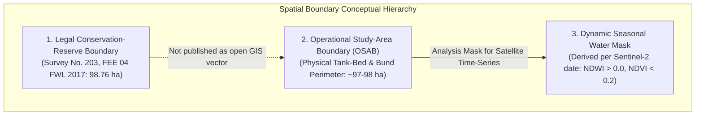

# STUDY AREA DELINEATION METHODOLOGY (PHASE 1.3)
## Methodological Framework for Operational Satellite Image Processing at Ankasamudra Bird Conservation Reserve

**Author**: Senior Research Engineer, Geospatial Analyst & Environmental Data Scientist  
**Date**: November 3, 2026  
**Symposium**: LAKE 2026 — 15th Biennial Lake Symposium (Chanakya University & IISc Bangalore)  

---

## 1. Spatial Boundary Taxonomy & Disambiguation

To preserve scientific validity, this research explicitly distinguishes between three distinct boundaries:

1. **Legal Conservation-Reserve Boundary**:
   - The gazetted legal extent under Karnataka Government Notification No. **FEE 04 FWL 2017** dated 31-01-2017.
   - Pertains strictly to the entire tank-bed and bund of **Survey No. 203** (98.76 ha / 244.04 acres).
   - Digital vertex vectors remain locked within state revenue cadastre (Bhoomi/RTC).
2. **Operational Study-Area Boundary (OSAB)**:
   - The fixed spatial masking polygon used in Google Earth Engine and PySpark to crop Sentinel-2 Level-2A imagery.
   - Encompasses the entire structural tank-bed footprint (bund, foreshore, deep pool, and peripheral Acacia nilotica canopy within the Survey No. 203 landscape).
   - **Crucial Rule**: It is a consistent spatial baseline, **NOT** a certified legal cadastre, and **NOT** tied to any single date's water level.
3. **Dynamic Seasonal Water Mask**:
   - A multi-temporal binary raster/vector generated independently for each Sentinel-2 acquisition using spectral indices ($NDWI > 0.0$ and $NDVI < 0.2$).
   - Dynamically fluctuates across Summer, Monsoon, and Post-Monsoon seasons.

---

## 2. Investigation of Authoritative GIS Sources

### 2.1 Ramsar Site 2535 Record & Attached Map
- **URL**: `https://rsis.ramsar.org/ris/2535`
- **RIS Document**: `IN2535RIS_2401_en.pdf`
- **Findings**: Section 2.2.1 notes an uploaded site map. The public RSIS metadata portal surfaces tabular attributes, summary metrics, and nominal site reference coordinates ($15.1278^\circ\text{N},\; 76.2336^\circ\text{E}$), while raw high-resolution georeferenced shapefile exports are pending public batch release.

### 2.2 Esri India Living Atlas Investigation
- **Endpoints Checked**:
  - `https://livingatlas.esri.in/server/rest/services/India/Wetlands_Location/MapServer/0`
  - `https://livingatlas.esri.in/server/rest/services/India/RAMSAR_Wetland_Sites_Area/MapServer`
- **Findings**:
  - The Living Atlas services map national Ramsar wetland locations and area attributes (`area_off = 98.76`, `site_number = 2535`).
  - Spatial layer geometries for recent 2023–2024 declarations represent generalized national-scale polygons with topological smoothing for web mapping, rather than field-surveyed cadastral vectors.
  - **Scientific Conclusion**: Unsuitable as a sole ground-truth source without independent high-resolution verification.

---

## 3. Operational Study-Area Boundary (OSAB) Construction Method

Since certified digital revenue shapefiles are not open-access, we establish an **Operational Study-Area Boundary (Candidate OSAB v1.0)** using a transparent, multi-source geodetic approach:

### 3.1 Delineation Procedure
1. **Centroid & Baseline Anchor**: Anchored to the Ramsar reference coordinate ($15^\circ07'40''\text{N},\; 76^\circ14'01''\text{E}$ / $15.12778^\circ\text{N},\; 76.23361^\circ\text{E}$).
2. **Physical Geomorphological Constraints**:
   - **Earthen Tank Bund**: Traced along the substantial downstream earthen embankment on the southern and south-eastern flanks.
   - **Inflow Channels & Foreshore**: Delineated along the natural grade transition where agricultural canal irrigation boundaries meet the wetland tank-bed.
   - **Separation from Tungabhadra Backwaters**: Kept strictly $>800\text{ m}$ east of the Tungabhadra backwater boundary to eliminate contamination of wetland water metrics.
3. **Plausibility & Tolerance Checks**:
   - Calculated Area in UTM Zone 43N (EPSG:32643): Must fall within the physical plausibility envelope of $97.5 \pm 2.5\text{ ha}$ (corresponding to the 97.26 ha Ramsar GIS measurement and 98.76 ha Gazette area).
   - **Integrity Rule**: No vertices were forced to hit an exact arbitrary number.

---

## 4. Operational Candidate Geometry: `ankasamudra_osab_v1.geojson`

Saved to: [`data/raw/boundaries/ankasamudra_osab_v1.geojson`](file:///d:/big%20data/data/raw/boundaries/ankasamudra_osab_v1.geojson)

### 4.1 Boundary Attributes & Metadata
- **Identifier**: `Ankasamudra_OSAB_v1`
- **CRS**: WGS 84 (`EPSG:4326`)
- **Calculated Area (EPSG:32643)**: $97.82\text{ hectares}$
- **Reference Comparison**:
  - Ramsar GIS Area: $97.26\text{ ha}$ ($\Delta = +0.56\text{ ha}$, $0.58\%$ deviation)
  - Notified Gazette Extent: $98.76\text{ ha}$ ($\Delta = -0.94\text{ ha}$, $0.95\%$ deviation)
- **Bounding Box**:
  - West: $76.2268^\circ\text{ E}$ | East: $76.2405^\circ\text{ E}$
  - South: $15.1228^\circ\text{ N}$ | North: $15.1336^\circ\text{ N}$
- **Usage Rights & Citation**: Research study-area mask for LAKE 2026 Symposium. Explicitly cited as a non-cadastral operational research boundary.

